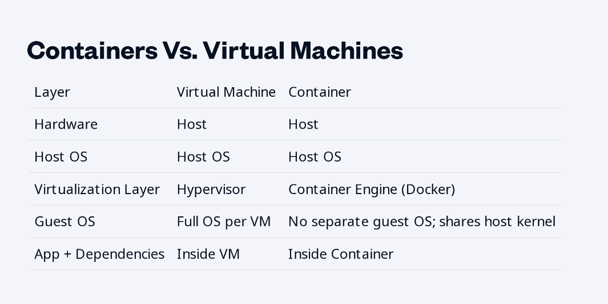

# Running containers



## Some Docker commandes

```bash
- docker --version
- docker run [docker image]
Ex: docker run hello-world

```

Pulling image from docker hub

```bash
docker pull nginx:latest # pull the lastest nginx image from docker hub

docker run -d --name my-nginx -p 8080:80 nginx:latest

```

Creating a container with the latest nginx image with -d name my-nginx

### listing and inspecting running containers

`docker ps` : just list currently running containers

`docker ps -a` : list all containers plus stop onces `docker ps --all`

### View logs for a specific container

docker logs [container name]

Ex: `docker logs my-nginx`

### Executing commands inside a running container

`docker exec -it my-nginx bash`

The `-it` combination combines two flags:

- `i` (**interactive**): Keeps the standard input (`STDIN`) open, allowing you to send commands to the container.
- `t` (**pseudo-TTY**): Allocates a pseudo-terminal, formatting the output and giving you an interactive prompt.

Together, they let you interact with the shell just like a normal terminal session.

> Note: we can replace `bash` with `sh`

### Managing the container lifecycle

`docker stop my-nginx`

`docker start my-nginx`

`docker rm my-nginx`

> Note: Container logs are the output from the container process. Docker saves them when the container exits.

### Delete all the containers

`docker rm -f $(docker ps -aq)`
